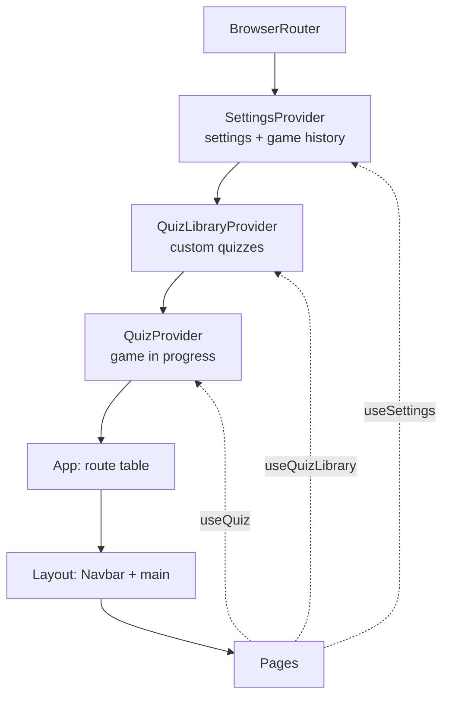
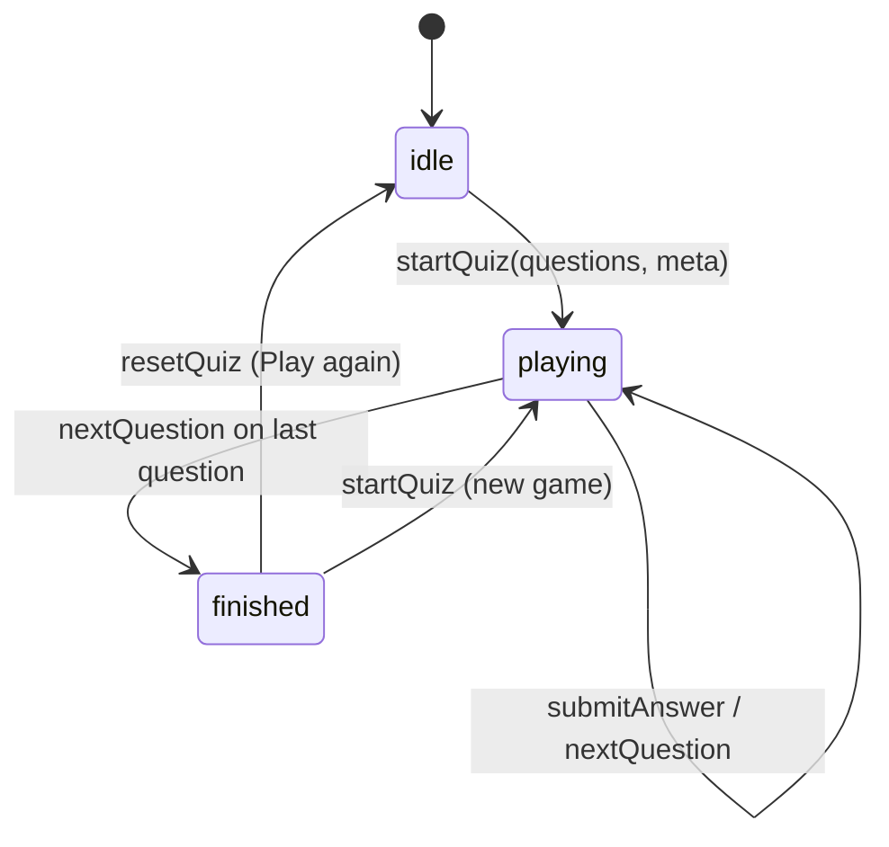

# Quiz Game

A single-page trivia app built with React and Vite. Players answer timed multiple-choice
questions from [Open Trivia DB](https://opentdb.com), from our own Cambodia question bank,
or from quizzes they write themselves,
get instant feedback, and compare scores on a local leaderboard. There is no backend:
all state lives in React Context and is saved to `localStorage`.

## Tech stack

| Layer      | Choice                                                   |
| ---------- | -------------------------------------------------------- |
| UI         | React 19 (function components + hooks, StrictMode)       |
| Routing    | React Router 7 (`BrowserRouter`, nested layout route)    |
| Build      | Vite 8 with `@vitejs/plugin-react`                       |
| Styling    | CSS Modules per component + global CSS variables         |
| State      | React Context, one provider per domain                   |
| Storage    | `localStorage` through a `useLocalStorage` hook          |
| Data       | Open Trivia DB REST API (no key) + Cambodia question bank in `src/data/` |
| Linting    | ESLint 10 flat config, `react-hooks` + `react-refresh`   |

## Getting started

Requires Node.js 20.19+ or 22.12+ (needed by Vite 8).

```bash
npm install
npm run dev        # http://localhost:5173
```

| Command           | What it does                                |
| ----------------- | ------------------------------------------- |
| `npm run dev`     | Dev server with hot reload                  |
| `npm run build`   | Production build into `dist/`               |
| `npm run preview` | Serve the production build locally          |
| `npm run lint`    | Run ESLint on the whole project             |

### Deploy

The app is a static site, so it deploys to [Vercel](https://vercel.com) with no extra setup:
import the GitHub repo and keep the detected Vite preset (build `npm run build`, output
`dist`). Every push to `main` redeploys.

`vercel.json` sends every path to `index.html`, so refreshing on a page like `/leaderboard`
loads the app instead of a 404. React Router then shows the right page.

## Architecture

`main.jsx` mounts the providers once, around the whole app. Pages never talk to
`localStorage` directly: they read and change state through hooks that wrap each context.



| Context               | Hook               | Persisted                 | Holds                                                                                          |
| --------------------- | ------------------ | ------------------------- | ---------------------------------------------------------------------------------------------- |
| `SettingsContext`     | `useSettings()`    | yes (`settings`, `history`) | `settings`, `updateSettings`, `history`, `addResult`, `clearHistory`                         |
| `QuizLibraryContext`  | `useQuizLibrary()` | yes (`quizzes`)           | `quizzes`, `getQuiz`, `createQuiz`, `updateQuiz`, `deleteQuiz`                                 |
| `QuizContext`         | `useQuiz()`        | no (memory only)          | `questions`, `currentIndex`, `currentQuestion`, `answers`, `score`, `total`, `status`, `quizMeta`, `startQuiz`, `submitAnswer`, `nextQuestion`, `resetQuiz` |

Each context object lives in its own `*ContextObject.js` file, separate from its provider,
so Vite's fast refresh keeps working (a file should export components only).

`score` and `total` are derived from `answers` and `questions` on every render, never stored.

## Routes

All paths are defined once in `ROUTES` (`src/siteConfig.js`). Every page renders inside
`<Layout />`.

| Path               | Page              | Purpose                                                    |
| ------------------ | ----------------- | ---------------------------------------------------------- |
| `/`                | `HomePage`        | Greeting, current setup, best score, start button          |
| `/settings`        | `SettingsPage`    | Player name, question source, difficulty, count, category  |
| `/quiz`            | `QuizPage`        | Play a quiz from the source in Settings (Open Trivia or Cambodia) |
| `/quiz?set=<id>`   | `QuizPage`        | Play a custom quiz from the library                        |
| `/results`         | `ResultsPage`     | Score, answer review, saves the game to history            |
| `/leaderboard`     | `LeaderboardPage` | Past games, filter by difficulty, summary stats            |
| `/my-quizzes`      | `MyQuizzesPage`   | Custom quiz library: play, edit, delete, export as JSON    |
| `/create`          | `CreateQuizPage`  | Create a custom quiz                                       |
| `/create/:quizId`  | `CreateQuizPage`  | Edit an existing custom quiz                               |
| `*`                | `NotFoundPage`    | Unknown URL                                                |

## Game flow



1. **Load.** `QuizPage` fetches questions from the API, picks them from the Cambodia bank,
   or converts a custom quiz from the library (answers shuffled). It then calls `startQuiz`. The load runs inside a cancellable
   `setTimeout` so StrictMode's double effect does not call the API twice.
2. **Answer.** Clicking an option calls `submitAnswer(answer)`. Each question accepts one
   answer only. `QuestionCard` reveals correct / wrong states and an `aria-live` message.
3. **Timer.** `useTimer` counts down per question: easy 20 s, medium 15 s, hard 10 s.
   At zero it records `submitAnswer(null)` and shows the correct answer.
4. **Finish.** After the last question `status` becomes `finished` and the page navigates to
   `/results`.
5. **Save.** `ResultsPage` calls `addResult` exactly once (guarded by a ref). Opening
   `/results` without a finished game redirects to `/`.

While a game is `playing`, the navbar asks for confirmation before leaving.

## Data model

```ts
// A question ready to play (from the API or converted from a custom quiz)
Question = {
  id: string
  question: string          // plain text, HTML entities decoded
  answers: string[]         // shuffled, includes correctAnswer
  correctAnswer: string
  difficulty: 'easy' | 'medium' | 'hard'
  category: string          // API or Cambodia category, or the custom quiz title
}

// One recorded answer in QuizContext
Answer = { questionId: string, selected: string | null, isCorrect: boolean }  // null = time up

// A quiz written by the player
CustomQuiz = {
  id: string
  title: string             // 1–60 characters
  description: string
  difficulty: 'easy' | 'medium' | 'hard'
  questions: { id, question, answers: string[], correctAnswer }[]  // 1–50 questions, 2–4 unique answers
  createdAt: string         // ISO date
  updatedAt: string
}

// One finished game in the leaderboard
HistoryEntry = {
  id: string
  playerName: string        // 'Guest' when empty
  quizTitle: string         // 'Open Trivia', 'Cambodia[: <category>]' or the custom quiz title
  difficulty: 'easy' | 'medium' | 'hard'
  score: number
  total: number
  date: string              // ISO date
}
```

The leaderboard sorts by percentage (highest first), then by date (newest first).

## Persistence

| Key                   | Value             | Default                                                          |
| --------------------- | ----------------- | ---------------------------------------------------------------- |
| `quiz-game:settings`  | settings object   | `{ playerName: '', source: 'opentdb', difficulty: 'easy', amount: 10, category: '' }` |
| `quiz-game:history`   | `HistoryEntry[]`  | `[]`                                                             |
| `quiz-game:quizzes`   | `CustomQuiz[]`    | one sample quiz, "Web Dev Basics"                                |

`useLocalStorage(key, initialValue)` behaves like `useState` and also:

- reads the saved value once on mount and writes it back on every change;
- merges saved objects over the defaults, so new settings fields get a default value;
- falls back to the default when the stored JSON is missing or broken;
- ignores write errors (private mode, full storage);
- listens to the `storage` event, so other open tabs stay in sync.

## External API

`src/services/triviaApi.js` is the only module that talks to the network.

| Function                                         | Endpoint                                                      |
| ------------------------------------------------ | ------------------------------------------------------------- |
| `fetchQuestions({ amount, difficulty, category })` | `https://opentdb.com/api.php?amount=&difficulty=&type=multiple[&category=]` |
| `fetchCategories()`                              | `https://opentdb.com/api_category.php`                        |

Responses are decoded (`decodeHtml`), shuffled (`shuffle`, Fisher–Yates) and mapped to
`Question`. Failures become errors with a message the player can read:

| Case                         | Message                                                                       |
| ---------------------------- | ----------------------------------------------------------------------------- |
| Network error / HTTP error   | Could not reach the quiz server. Check your connection.                       |
| `response_code` 1            | Not enough questions for these settings. Try fewer questions or another category. |
| `response_code` 5            | Too many requests. Please wait a few seconds and try again.                   |
| Any other non-zero code      | Something went wrong loading questions.                                       |

Open Trivia DB allows one request every 5 seconds per IP.

Settings does not list all of Open Trivia's categories. It offers a short list of six,
`OPEN_TRIVIA_CATEGORIES` in `siteConfig.js`: General Knowledge, History, Geography,
Science & Nature, Music and Sports. Edit that list to change them; the `id` is the
Open Trivia category id. A saved category that is no longer in the list counts as
*Any category*.

## Cambodia question bank

Open Trivia DB has almost nothing about Cambodia, so we keep our own English questions in
the repo. They load instantly and work offline.

```
src/data/cambodia/
├── index.js          CAMBODIA_CATEGORIES, getCambodiaQuestions(), countCambodiaQuestions()
├── angkor.js         Angkor & Heritage
├── history.js        History
├── geography.js      Geography
├── culture.js        Culture & Traditions
├── food.js           Food
└── languageArts.js   Language & Arts
```

Each question looks like this:

```js
{
  id: 'food-e1',                       // unique: <category>-<e|m|h><number>
  difficulty: 'easy',
  question: 'Fish amok is traditionally steamed in what?',
  correctAnswer: 'Banana leaves',
  incorrectAnswers: ['Bamboo tubes', 'Clay pots', 'Coconut shells'],
  verified: false,                     // true once a teammate has fact-checked it
}
```

- Choose **Cambodia** under *Question source* in Settings. The category list then shows these
  six categories, plus a count of how many questions match the chosen difficulty.
- *Any category* mixes all six. A single category plays every matching question it has,
  up to the chosen amount.
- Write questions in your own words. Quiz websites such as FunTrivia are copyrighted, so
  do not copy their questions.

## Styling

- `src/index.css` defines the design tokens as CSS variables (`--text`, `--bg`, `--accent`,
  `--border`, …) for a black, white and navy theme, plus shared base styles such as `.button`.
- Each component has a `Name.module.css` next to it, so class names never clash.
- The layout is a single column, at most 720px wide, with 16px side padding on phones.
  Answer options use a 2×2 grid on desktop and one column on small screens.

## Project structure

```
src/
├── main.jsx               entry: StrictMode, router, providers
├── App.jsx                route table
├── siteConfig.js          ROUTES, DIFFICULTIES, QUESTION_AMOUNTS, QUESTION_SOURCES, OPEN_TRIVIA_CATEGORIES, DEFAULT_SETTINGS, STORAGE_KEYS
├── index.css              global tokens and base styles
├── pages/                 one component per route (+ .module.css)
├── components/
│   ├── Layout/            Layout, Navbar
│   ├── Quiz/              QuestionCard, AnswerOption, ProgressBar
│   ├── Leaderboard/       ScoreTable
│   └── QuizBuilder/       QuestionEditor, QuizSetCard
├── context/               providers + context objects
├── hooks/                 useSettings, useQuiz, useQuizLibrary, useLocalStorage, useTimer
├── services/              triviaApi
├── data/cambodia/         our own Cambodia questions, one file per category
└── utils/                 decodeHtml, shuffle
```

## Conventions

- Start each source file with a header comment that says what it does and what it
  exports, and read it before changing the file.
- Import paths and constants from `siteConfig.js` instead of hard-coding strings.
- Pages use hooks (`useSettings`, `useQuiz`, `useQuizLibrary`); only providers touch storage.
- Hooks are named `useSomething`; components are PascalCase, one per file.
- Commit messages use a `feat:` / `fix:` prefix.
- Before opening a pull request: `npm run lint` and `npm run build` pass, and the change
  works at phone width.

## Team

| Member    | Branch | Area                                                   |
| --------- | ------ | ------------------------------------------------------ |
| dontpanic | `main` | Routing, global state, layout, integration, review     |
| chea      | `chea` | Quiz gameplay, results, trivia API, timer              |
| tesroth   | `roth` | Home, settings, leaderboard, custom quizzes, storage   |

Work happens on each member's branch and reaches `main` through a pull request.
